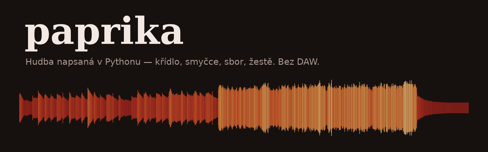
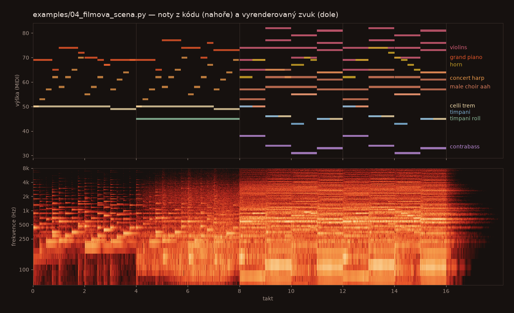

<p align="center">
  
</p>

<p align="center">
  <a href="#poslechni-si">Poslechni si</a> ·
  <a href="#instalace">Instalace</a> ·
  <a href="#rychlý-start">Rychlý start</a> ·
  <a href="#skutečné-nástroje">Nástroje</a> ·
  <a href="#zpětná-vazba-bez-poslechu">Zpětná vazba</a> ·
  <a href="#reference-api">API</a>
</p>

<p align="center">
  
  
  
</p>

# Paprika

**Skladba je Python soubor. Paprika z něj udělá WAV — s nahrávkami skutečného
koncertního křídla, smyčců, dechů, žestí, tympánů a lidských hlasů.**

Žádná DAW, žádné VST pluginy, žádný generátor hudby. Melodii, harmonii
a strukturu napíšeš ty (nebo AI) jako noty v kódu. Paprika dodá nástroje,
hudební teorii, efekty, mix a hlavně **textovou zpětnou vazbu**: po každém
renderu vypíše, co v mixu nesedí, a `check` za vteřinu najde špatný bas nebo
nerozvedený tón — bez poslechu. Proto se s ní dobře skládá i z terminálu
a s AI asistentem, který neslyší.

> **In English:** Paprika is a pure-Python music library. You write a song as
> a Python module (notes, chords, harmony plan) and render it to WAV using real
> sampled instruments (Salamander Grand Piano, VSCO 2 CE orchestra, VocalSet
> choir and soloists) plus hand-written synthesis and effects. A text report and
> a music-theory checker give feedback without listening — built for composing
> together with an AI. Docs and messages are in Czech; the code reads fine either way.

## Poslechni si

Všech pět ukázek je v [`examples/`](examples/) — krátké, čitelné soubory,
které jde rovnou upravovat. MP3 v [`docs/audio/`](docs/audio/) jsou
vyrenderované přesně z nich, bez jakékoliv úpravy v jiném programu.

| | Ukázka | Co je slyšet | Kód |
|---|---|---|---|
| 🎹 | [**Klavír**](docs/audio/01_klavir.mp3) | koncertní křídlo, levá ruka rozložené akordy, pedál | [`01_klavir.py`](examples/01_klavir.py) |
| 🎻 | [**Smyčce**](docs/audio/02_smycce.mp3) | smyčcový orchestr, sólové housle legato, crescendo jedním tónem | [`02_smycce.py`](examples/02_smycce.py) |
| 🎶 | [**Sbor a soprán**](docs/audio/03_sbor.mp3) | ženský a mužský sbor „óó“, sólový soprán, křídlo | [`03_sbor.py`](examples/03_sbor.py) |
| 🎬 | [**Filmová scéna**](docs/audio/04_filmova_scena.mp3) | harfa, víření tympánů, téma v lesním rohu, sbor, celý orchestr | [`04_filmova_scena.py`](examples/04_filmova_scena.py) |
| 🎼 | [**Kontrola teorie**](docs/audio/05_kontrola_teorie.mp3) | křídlo, cella, housle — a ukázka, jak `check` najde chybu | [`05_kontrola_teorie.py`](examples/05_kontrola_teorie.py) |

<p align="center">
  
  <br><sub>Filmová scéna: nahoře noty tak, jak jsou napsané v kódu, dole spektrogram toho, co z nich Paprika vyrenderovala.</sub>
</p>

## Co umí

- **Skutečné nástroje.** Vestavěný SFZ sampler přehrává nahrávky: křídlo
  s 16 dynamickými vrstvami, smyčce (sekce i sóla, `sus trem pizz spic`),
  dřevo, žestě, harfa, tympány, mallets a sbor i sólisté (soprán, alt, tenor,
  bas). Velocity mění barvu tónu, ne jen hlasitost; legato, round robin,
  pedál a plynulá dynamika jako modwheel ve filmových knihovnách.
- **Noty jako text.** `"A4:2 D5:1 E5:1 | F5:4"` — takt oddělený `|`
  a Paprika hlídá, že délky sedí. Akordy jménem (`Dm7`, `Bb/D`) nebo
  arpeggio jedním voláním.
- **Harmonický plán a kontrola teorie.** `s.harmony("i | VI | iv | V")`
  a `python -m paprika check` porovná noty s plánem: bas, nevlastní tóny,
  paralely, citlivý tón, kadence. Za vteřinu, bez renderu.
- **Report po renderu.** Hlasitost, clipping, 7 frekvenčních pásem, stereo,
  maskování mezi stopami, robotická dynamika, noty mimo rozsah nástroje.
- **Mix jako v DAW.** Konvoluční hall, delay, EQ, kompresor, sidechain,
  sběrnice, automatizace čehokoliv v čase, hotové master řetězy.
- **Lidské zvuky.** Nádechy sólisty podle frází (z nahrávek skutečných
  zpěváků nebo z fyziky proudu vzduchu), bručení, vzdech, smích a námaha
  z modelu hlasivek a hlasového traktu, mlasknutí, tep, šustění oblečení
  a kroky, blízký mikrofon s proximity efektem a šumem místnosti. Report
  hlídá, že nádech nejde přes noty a fráze se vejde do jednoho nádechu.
- **MIDI export** do jakékoliv DAW, když budeš chtít skladbu dodělat jinde.
- **Syntéza, když je potřeba.** 37 ručně napsaných presetů (pady, basy,
  sbor přes formanty, 808…), bicí sady a cinematic efekty (riser, impact,
  braam).
- **Čistý Python.** Závislosti jen `numpy` a `scipy`. Oscilátory, obálky,
  efekty, limiter, sampler i MIDI writer jsou napsané ručně a čitelné.

## Instalace

```bash
git clone https://github.com/Voku199/paprika.git
cd paprika
pip install -r requirements.txt               # numpy + scipy

python -m paprika samples install all         # nahrávky nástrojů, ~4.5 GB, jednou
```

Nahrávky se stáhnou **mimo repozitář** — do `%LOCALAPPDATA%\paprika\samples`
na Windows, jinde do `~/.paprika/samples` (jinam přes proměnnou
`PAPRIKA_SAMPLES`). Instalace pokračuje, kde skončila, a jde i po skupinách:

```bash
python -m paprika samples install piano       # jen křídlo, ~1 GB
python -m paprika samples install strings voices
python -m paprika samples breaths             # modely nádechů z VocalSet (po voices)
python -m paprika samples                     # co je nainstalované
```

Bez nahrávek fungují syntetizované nástroje, `check`, `show` i MIDI export.
Samplovaný nástroj bez nahrávek skončí srozumitelnou chybou s příkazem na
instalaci — Paprika nikdy potichu nepřepne na syntézu.

## Rychlý start

```python
# examples/moje.py
from paprika import Song, mastering

s = Song(bpm=66, key="D", scale="minor", bars=4)
s.harmony("Dm | Bb | Gm | A")                       # plán: co má kde znít

piano = s.track("grand_piano", fx="default")         # křídlo + hall
cello = s.track("celli", vol=0.6, pan=0.2, fx="default")
voice = s.track("soprano.ooh", vol=0.6, fx="default")
s.master.fx(*mastering("cinematic"))

for bar, ch in enumerate(["Dm", "Bb", "Gm", "A"]):
    piano.chord(ch, bar=bar, dur=4, octave=3, vel=64)
piano.pedal(bars=(0, 4), every=1)

cello.notes("D3:4 | Bb2:4 | G2:4 | A2:4", vel=80)
voice.melody("A4:2 D5:1 E5:1 | F5:3 D5:1 | D5:2 Bb4:1 G4:1 | E5:2 C#5:2", vel=84)

for t in (piano, cello, voice):
    t.humanize(timing=0.012, vel=0.08, seed=1)
```

```bash
python -m paprika check  examples/moje.py           # teorie, za vteřinu
python -m paprika render examples/moje.py --play    # output/moje.wav + report
```

Skladba je obyčejný Python modul. `render` ho naimportuje, najde v něm
**právě jednu** instanci `Song` na úrovni modulu a vyrenderuje ji do
`output/<jméno>.wav`. Všechno je v dobách (beatech), ne v sekundách —
změna tempa je jeden parametr.

Užitečné příkazy:

```bash
python -m paprika render  examples/04_filmova_scena.py --bars 6:10   # jen kus, rychle
python -m paprika show    examples/01_klavir.py --bars 0:4           # ASCII piano roll
python -m paprika midi    examples/04_filmova_scena.py               # output/*.mid
python -m paprika presets                                            # syntetické nástroje
python -m paprika compare reference.mp3 output/moje.wav              # mix proti referenci
```

## Skutečné nástroje

| Skupina | Nástroje (`jméno.artikulace`, první je výchozí) |
|---|---|
| piano | `grand_piano` (Yamaha C5, 16 dynamik), `upright_piano` |
| strings | `violins`, `violas`, `celli` (`sus trem pizz spic`), `violin_solo` (`sus trem pizz spic`), `contrabass` (`sus nv trem pizz spic`), `concert_harp` |
| winds | `flute` (`sus nv exp stac`), `oboe` (`sus nv stac`), `clarinet` (`sus stac`), `bassoon` (`sus vib stac`) |
| brass | `horn` (`sus stac mute`), `trumpet` (`sus vib stac mute`), `trombone` (`sus vib stac`), `tuba` (`sus stac`) |
| mallets | `marimba`, `glockenspiel`, `xylophone` |
| percussion | `timpani` (`hit roll`) — pět kotlů, úder dozní sám, víření drží smyčkou |
| voices | `male_choir`, `female_choir`, `soprano`, `alto`, `tenor`, `basso` (`aah oh ooh eh`) |

```python
piano = s.track("grand_piano", fx="default")        # Hall
piano.notes("(D2 A2 F3):4", bar=0).pedal(bars=(0, 8), every=1)
violin = s.track("violin_solo", fx="default")       # sólo = mono = legato
violin.melody("A4:2 >D5:1 E5:1 | F5:4", bar=8)
s.track("celli.pizz").notes("D3:1 _:1 A2:1 _:1", bar=8)
choir = s.track("female_choir.ooh", fx="default")   # katedrála
choir.chord("Dm", bar=0, dur=8, octave=4)
```

- **Velocity mění barvu**, ne jen hlasitost (dynamické vrstvy nahrávky):
  piano 16 vrstev, smyčce 2–3. Piš dynamiku 40–115, ne všude 100.
  Pozor na hranici vrstev (u dvou vrstev 64): humanize kolem ní nahodile
  přepíná nahrávky — piš buď zřetelně pod, nebo nad.
- **Plynulá dynamika** `t.automate("dyn", [(takt, faktor), ...])` — jako
  modwheel ve filmových knihovnách: faktor násobí velocity not v čase a
  vrstvy nahrávky se prolnou, takže jeden dlouhý tón umí crescendo
  i decrescendo. 1.0 = beze změny. Jen samplované stopy:

  ```python
  violins.note("D5", at=0, dur=16, vel=110)
  violins.automate("dyn", [(0, 0.3), (3, 1.0), (4, 0.6)], "s")
  ```

- **Pedál** `t.pedal(bars=(od, do), every=1)` — nota, která skončí při
  sešlápnutí, zní do uvolnění; `every` přešlápne se změnou harmonie.
- **Legato** — sólové nástroje (`violin_solo`, `contrabass`, dechy, žestě,
  sólové hlasy) jsou mono: navazující noty se prolnou bez nového nasazení.
  Na polyfonní stopě legato zapne `>` před notou nebo `mono=True`.
- **Round robin** — opakovaná nota vezme jinou nahrávku, nezní jako kulomet.
- **Rozsah** — nota mimo rozsah nahrávek se natáhne a zní nepřirozeně;
  report hlásí `mimo rozsah` s taktem a rozsahem nástroje.
- **Vlastní knihovny**: `s.track(Sampler("cesta/k/nastroji.sfz", legato=True))`.

**Zpěv** je z VocalSet. Sbory mají šest hlasů na klávesu rozestavěných do
stran, bez vibrata; sólisté zpívají s vibratem a legato. Artikulace je
samohláska, velocity přepíná piano / forte nahrávky. Instalace nahrávky
rozřeže na jednotlivé tóny, oktávu každého ověří řadou harmonických a pod
nejnižší zazpívaný tón dopočítá tři hlubší přes TD-PSOLA (výška klesne,
samohláska zůstane). Rozsahy: `basso` E2–F4, `tenor` C3–C5, `alto` F#3–G5,
`soprano` F#3–A5. Zpěv s textem Paprika neumí.

## Zpětná vazba bez poslechu

Paprika vznikla pro skládání s AI, která výsledek neslyší. Proto každý krok
vrací text, podle kterého se dá pokračovat.

**`check`** — harmonie a teorie, bez renderu, za vteřinu. Tady s chybou
z [`05_kontrola_teorie.py`](examples/05_kontrola_teorie.py) (odkomentovaný
řádek `CHYBA`):

```
$ python -m paprika check examples/05_kontrola_teorie.py
PAPRIKA CHECK  05_kontrola_teorie.py
skladba  66 BPM  A minor  8 taktů  3 stop  teorie: free

HARMONIE A (0–3)      i | iv | VII | III
HARMONIE B (4–7)      VI | iv | V7 | i
AKORDY   i=Am  iv=Dm  VII=G  III=C  VI=F  V7=E7
KADENCE  A (0–3): VII → III bez kadence · B (4–7): V7 → i autentická

WARN  celli          bar 2   A#2 mimo A minor
WARN  celli          bar 2   bas Bb2 nepatří do akordu G (VII) — plán chce v basu G (nebo jiný tón akordu)
```

**Report po renderu** — mix, pásma, stereo, hlasitost stop a co nesedí:

```
$ python -m paprika render examples/03_sbor.py
PAPRIKA  03_sbor.wav
render   0:38  44100 Hz  stereo  4 stop  81 not  [10.5s]

MIX      peak -10.7 dBFS   rms -26.1 dB   no clipping
BANDS    sub 0% bass 15% lowmid 24% mid 60% himid 1% pres 0% air 0%   [ok]
STEREO   šířka 18 %   korelace 0.64   [ok]
TRACKS   female_choir_ooh -34.6 dB | male_choir_ooh -32.9 dB | soprano_aah -29.2 dB | grand_piano -35.0 dB

WARN  female_choir_ooh + male_choir_ooh maskování 250-4000 Hz, bars 0-7
```

**`show`** — ASCII piano roll, rychlá kontrola struktury bez renderu:

```
$ python -m paprika show examples/01_klavir.py --bars 0:4
       |0       |1       |2       |3       |
chords |Am      |F       |C       |G       |
leva   |AEACECAE|FCFACAFC|CGCEGECG|GDGBDBGD|
prava  |E--DC-B-|A---C-F-|E--DC-E-|D-----B-|
```

Onset noty je písmeno tónu (malé písmeno = křížek), držení `-`, ticho `.`.

Doporučený postup: **harmonie → party → `check` → `render --bars` na kus →
report → oprava → celý render.**

---

# Reference API

## Notace not

```
C#4:1.5        nota, oktáva, dvojtečka, délka v dobách
(C4 E4 G4):2   akord — celý naráz
_:2            pauza
~:1            prodlouží předchozí notu
>G1:1          glide / legato — nota naváže na předchozí
C4:1@110       volitelná velocity
|              oddělovač taktů a zároveň kontrola délek
```

Když součet délek v taktu nesedí na `Song.beats_per_bar`, letí
`NoteLengthError` s číslem taktu — překlep v rytmu se pozná hned, ne až
podle zvuku.

## Metody stopy

| Metoda | Co dělá |
|---|---|
| `.note(pitch, at, dur, vel)` | jedna nota, `at` v dobách od začátku skladby |
| `.notes(str, bar=)` | řetězec not od daného taktu |
| `.melody(str, bar=)` | totéž, čitelnější jméno pro melodické linky |
| `.chord(name, bar, dur, inv=0, octave=4)` | akord podle jména nebo seznamu výšek |
| `.arp(name, bar, pattern, rate, octaves)` | arpeggio; `up`/`down`/`updown`/`downup`/`random` |
| `.pedal(bars=(od, do), every=)` | sustain pedál |
| `.fx(*efekty)` | připojí efektový řetěz |
| `.humanize(timing, vel, seed, corr=0)` | rozhýbe časování (v dobách) a dynamiku (relativně); `corr` 0.8–0.95 = odchylky s pamětí jako u živého hráče |
| `.clear(bars=)` | smaže rozsah taktů |
| `.transpose(semitones)` | posune celou stopu |
| `.repeat(bars, times)` | zkopíruje rozsah taktů dál po timeline |
| `.automate(cíl, [(takt, hodnota)], curve)` | změna v čase: `vol`, `pan`, `dyn`, `<efekt>.<param>`; křivky `lin`, `exp`, `s`, `step` |
| `.to(bus)` | pošle stopu do sběrnice |

`s.track(nástroj, vol, pan, mono=, glide=, fx=)` — `fx="default"` připojí
doporučený řetěz nástroje (křídlo → hall, sbor → katedrála). Metody vrací
`self`, takže jdou řetězit.

`s.bus("strings")` je sběrnice s vlastním fx řetězem a automatizací;
`s.master` je poslední řetěz před limiterem.

```python
bus = s.bus("orchestr").fx(Compressor(-16, 2))
violins.to(bus); celli.to(bus)
choir.fx(Sidechain("timpani", amount=0.3))            # uhne úderům tympánů
violins.automate("vol", [(0, 0.0), (8, 0.6)], "s")     # pomalý nástup
s.master.automate("vol", [(0, 1), (15.875, 0), (16, 1)], "step")  # díra ticha
```

**Humanize s pamětí.** `humanize(corr=0)` posouvá každou notu nezávisle.
Živý hráč se ale od mřížky odchyluje plynule — odchylky jsou dlouhodobě
korelované a posluchači je hodnotí jako lidštější (Hennig et al. 2011).
`corr=0.85` zapne paměť: tóny akordu se posunou spolu s malým vlastním
rozptylem a silnější tón přijde o chlup dřív. Rozsah zůstává ±`timing`
a ±`vel`, `corr=0` je bit-identické s dřívějším chováním.

## Harmonický plán a kontrola teorie

Plán říká, jaký akord má v kterém taktu znít. Zvuk neovlivní; podle něj
`check` (a report po renderu) hlídá bas, nevlastní tóny, vedení hlasů
a kadence:

```python
s = Song(bpm=70, key="D", scale="minor", bars=16)   # theory="free" je výchozí
s.harmony("Dm | Bb | Gm | Gm:2 A:2")                # jména akordů
s.harmony("i | VI | iv | V7/V", bar=4)               # římské číslice vůči key/scale
s.section("A", bars=(0, 8)).section("B", bars=(8, 16))
```

- `|` odděluje takty a hlídá délky (`HarmonyError` s číslem taktu), `Gm:2`
  je akord na dvě doby, akordy bez délky si dělí takt rovným dílem
  (`Gm A` = po půl taktu), `_` = bez akordu.
- Jméno akordu je základ + kvalita, lomítko je bas: `Dm/F`.
- Římská číslice: velká = dur, malá = moll, `o` zmenšený, `ø7` malý
  zmenšený septakord, `+` zvětšený, `7` diatonická septima (`I7` = Cmaj7,
  `V7` = G7), `6`/`64`/`65`/`43`/`42` obraty, `add6` přidaná sexta,
  lomítko = vedlejší akord (`V/V`, `V7/iv`, `viio7/V`), `b`/`#` posune
  základ (`bVII`). V mollu se stupně počítají od přirozeného mollu (`VI` =
  Bb v d moll), `V` je durová dominanta a `viio` stojí na citlivém tónu.
- Další `harmony()` přes stejné takty plán přepíše — jde psát po sekcích.

`Song(theory=...)` volí přísnost. `free` (výchozí) je pro filmovou a pop
hudbu: kontroluje samostatné linky, oktávová zdvojení, arpeggia, ostinata
a pady bere jako záměr. `strict` je učebnice (chorál, kvartet): rozdělí
vícehlasé stopy na hlasy a hlásí všechno jako WARN. `off` teorii vypne.

| Pravidlo | free | strict |
|---|---|---|
| bas na začátku akordu nepatří do akordu (prodleva se nehlásí) | WARN | WARN |
| v úseku akordu nezní jeho základ nebo tercie | INFO | WARN |
| nota linky na těžké době mimo akord, nerozvede se krokem | WARN, když je mimo stupnici, jinak INFO | WARN |
| paralelní kvinty a oktávy mezi linkami | INFO, jen izolované | WARN |
| citlivý tón v nejvyšším hlase ve V → I nejde na tóniku | INFO | WARN |
| melodie: skok ≥ malá sexta bez návratu, tritón | INFO | WARN |
| tercie pod G2 držená aspoň dobu | WARN | WARN |
| sousední horní hlasy dál než oktávu, křížení linek | — | WARN |

Nota, která je v akordu plánu, není „mimo stupnici“ — C# v dominantě A
v d moll je v pořádku i bez `chromatic=True`.

## Pravidla reportu

| Pravidlo | Podmínka |
|---|---|
| nota mimo stupnici | výška není ve `Song.scale` ani v akordu plánu a stopa nemá `chromatic=True` |
| mimo rozsah | nota leží mimo nahrávky samplovaného nástroje |
| clipping | jakýkoliv vzorek před limiterem přesáhne 1.0 |
| špatná hlasitost | peak nad −0.3 dBFS nebo RMS pod −30 dB |
| frekvenční maskování | dvě stopy mají obě přes 40 % energie ve stejném pásmu a čase |
| robotická dynamika | směrodatná odchylka velocity ve stopě je nula |
| ostrá disonance | malá sekunda mezi současně znějícími notami pod MIDI 48 |
| díra v aranži | stopa mlčí 4+ takty uprostřed skladby |
| mono kompatibilita | korelace L/R stopy klesne pod 0 — v mono se vyruší |
| statický zvuk | melodická stopa přes 16+ taktů bez modulace, automatizace i humanize |
| přetížený sub | víc než 15 % výkonu pod 60 Hz |
| úzké stereo | šířka mixu pod 8 % u skladby delší než 8 taktů |
| tenké středy | méně než 15 % výkonu v 250 Hz–4 kHz |
| nádech přes noty | nádech stopy `s.human(performer=...)` zasahuje do not interpreta (nejde dýchat a hrát zároveň) |
| chybí nádech | fráze bez pauzy je delší, než vystačí vzduch při její dynamice (~20 s v mp, ~10 s ve ff) |
| kulometný efekt | dva stejné lidské zvuky za sebou mají stejnou variantu |
| dech na mřížce (INFO) | 4+ nádechy, všechny se stejným odstupem od mřížky — chybí humanize |
| hlasitý nádech (INFO) | nádech je méně než 12 dB pod frází po něm (přirozeně 15–30 dB) |
| sterilní hlas | `Glottal` bez jitteru a shimmeru v patchi bez vibrata i driftu (lidský hlas: jitter 0.2–1 %, shimmer 1–4 %) |
| klipy z korpusu (INFO) | skladba používá `clip()` — vypíše licence a autory klipů k atribuci |

„Nádech přes noty“ platí i pro hlasová gesta (bručení, vzdech, smích,
námaha) a hlasové klipy z korpusu (smích, kašel, lapání po dechu, ...) —
jeden interpret nemůže zpívat a zároveň bručet. Maskování přeskakuje stopy
jen s krátkými gesty (nádech, výdech, mlasknutí, vzdech, smích, námaha
a jejich klipy) — zní zlomek taktu o desítky dB tišeji, jejich hlasitost
hlídá pravidlo hlasitého nádechu.

`compare` vypíše stejné metriky pro render a referenční nahrávku vedle sebe:

```
$ python -m paprika compare reference.mp3 output/moje.wav
soubor                          sub   bass lowmid    mid  himid ...  šířka
reference.mp3                  3.5%  41.8%  22.1%  27.9%   4.5% ...  29.4%
moje.wav                      11.0%  26.9%  36.2%  24.1%   0.9% ...  19.2%
  rozdíl proti prvnímu        +7.5  -14.9  +14.1   -3.8   -3.6
```

`analyze-ref` z cizí nahrávky odhadne tempo, tóninu, akordy po taktech
a dynamiku (čisté numpy, žádné ML; pro mp3 je potřeba
`pip install imageio-ffmpeg`).

## MIDI export

```bash
python -m paprika midi examples/04_filmova_scena.py      # output/04_filmova_scena.mid
python -m paprika midi songs/x.py -o hotove/x.mid
```

```python
from paprika import export_midi, read_midi
skipped = export_midi(s, "output/x.mid")   # vrátí, co se do MIDI nevešlo
mid = read_midi("output/x.mid")
```

Standard MIDI File formát 1, 480 ticků na dobu. Stopa 0 nese tempo, takt,
předznamenání, sekce jako markery a akordy plánu jako text. Každá stopa
dostane jméno a GM program (piano, smyčce, sbor…), pedál jde jako CC64, bicí
na kanál 10. SFX a automatizace se nevyexportují — export to vypíše.

## Efekty a mix

`Hall(preset, size, mix)` (konvoluce: `room` / `plate` / `hall` /
`cathedral`), `Reverb(room, mix, damp, width)`, `Delay(time, fb, mix,
ping_pong, tone)`, `LowPass`/`HighPass(cutoff, poles, res)`,
`Filter(mode, cutoff, res)`, `EQ(low, mid, high)`, `Saturate(drive)`,
`Compressor(threshold, ratio, attack, release, makeup)`, `Gate(pattern,
rate, depth)`, `Chorus`, `Width(amount)`, `BitCrush`, `Tape(wow, flutter,
drive, hiss)`, `Sidechain(zdroj, amount)` — zdroj je stopa nebo sběrnice,
`DynEQ(freq, q, threshold, ratio, range_db, source=)` — zvon, který stáhne
pásmo jen při přebytku energie (i podle jiné stopy), `Proximity(dist,
pattern)` a `RoomTone(level)` — blízký mikrofon (viz Lidské zvuky).
Každý efekt bere `name=` pro automatizaci (`"lowpass.cutoff"`).

`s.master.fx(*mastering("cinematic"))` — hotový master řetěz (také
`darkpop`, `lofi`): HP 30 Hz, jemné EQ, glue kompresor, lehká páska.

## Lidské zvuky

`s.human()` je stopa dechu, mlasknutí, tepu, šustění oblečení a kroků. Nejsou
to nahrané smyčky: nádech vychází z fyziky proudu vzduchu (objem za čas dává
průtok, slyšet je až turbulence nad prahem, která roste zhruba s U³, a trakt
ji zabarví podle samohlásky). Rychlý nádech v krátké pauze je proto
hlasitější a jasnější než pomalý hluboký a každý výskyt je jiná varianta —
dva nádechy za sebou nejsou stejný vzorek.

```python
from paprika import DynEQ

flute = s.track("flute")
dech = s.human("dech", performer=flute, vol=0.2)  # blízký mikrofon zapnutý
dech.breaths()                         # nádech před každou frází flétny
dech.lip_smack(3, beat=3.55)           # mlasknutí před prvním nástupem
dech.exhale(15, beat=3, kind="sigh")   # vzdech po poslední notě
dech.humanize(seed=4)                  # ±12 ms, korelovaně

telo = s.human("telo")
telo.steps((0, 3), every=1, surface="wood")
telo.cloth(3, beats=1.5, fabric="cotton", motion="fidget")
telo.heartbeat((0, 4), every=1)        # tepová frekvence = tempo / every
pad.fx(DynEQ(3500, threshold=-45, range_db=4, source="dech"))  # pad uhne dechu
```

| Metoda | Co dělá |
|---|---|
| `.breath(to_bar, beat, beats, depth, kind, vowel)` | nádech, který skončí v `to_bar` + `beat`; `kind` mouth / nose / catch, `depth` objem 0..1 |
| `.breaths(min_rest, kind="auto")` | nádechy před frázemi stopy `performer`: hloubka podle délky a dynamiky fráze, délka podle pauzy, v krátké pauze `catch`; končí 20 ms před nástupem (u akcentu 40 ms) |
| `.exhale(bar, beat, beats, depth, kind)` | výdech: mouth / nose / sigh (vzdech, čelist se přivírá) |
| `.lip_smack(bar, beat)` | mlasknutí rtů |
| `.heartbeat(bars, every)` | tep „lub-dub“, systola se zkracuje s tepem |
| `.cloth(bar, beat, beats, fabric, motion)` | šustění: cotton / nylon / wool, pohyb swing / fidget (profil minimálního trhnutí) |
| `.steps(bars, every, surface)` | kroky střídavě levá/pravá: stone / wood / gravel / dirt; s `pace`/`speed`/`weight` chodí člověk (viz Chůze a běh) |
| `.humanize(timing=None, vel, corr=0.6)` | časování (výchozí ±12 ms) i dynamika, korelovaně |

`s.human(name, vol=0.35, performer=, voice=, section=False, mic=True,
breath_model="auto")`: `performer` je stopa (nebo její jméno), jejíž
interpret dýchá — `breaths()` se řídí jejími frázemi, samohláska nádechu se
vezme z artikulace (`soprano.ooh` → „u“) a report hlídá, že nádech nejde
přes noty. `voice` male/female (výchozí podle jména nástroje),
`section=True` pro sbor nebo sekci, která dýchá střídavě (pravidla o dechu
se na ni nevztahují). `mic=True` přidá blízký mikrofon `Proximity(0.15)` +
`RoomTone()`, `mic=False` nechá zvuk suchý. `variant=` u metod vynutí
konkrétní variantu (je jich 8).

| Efekt | Co dělá |
|---|---|
| `Proximity(dist=0.15, pattern="cardioid", max_db=12, hp=50)` | proximity efekt směrového mikrofonu: shelf 1. řádu (s + k·c/r) / (s + k·c/ref); kardioida na 5 cm +14.6 dB na 100 Hz, na 30 cm +2.3 dB. `dist` jde automatizovat |
| `RoomTone(level=-66, color="pink", attack=0.08, release=0.5)` | šum místnosti jen tam, kde stopa zní (s náběhem a doběhem) — žádné digitální ticho pod blízkým zdrojem |
| `DynEQ(freq, q, threshold, ratio, range_db, source=)` | zvon, který stáhne pásmo jen při přebytku energie (ostré nádechy); `source` = klíč z jiné stopy |

### Chůze a běh

Pevné `steps((0, 4), every=1)` je metronom: stejná síla, stejný odstup,
každý krok jinak náhodný. Tak zní kroky „z kódu“. S `pace`, `speed`,
`weight` nebo `jitter` chodí člověk (`paprika/gait.py`):

```python
telo = s.human("telo", seed=7)          # seed = který chodec (jeho nohy)
telo.steps((0, 8), pace="walk", surface="gravel")             # 1.4 m/s, 75 kg
telo.steps((8, 12), speed=[(8, 1.4), (12, 3.5)], weight=90)   # rozběhne se
telo.steps((12, 16), pace="run", surface="dirt", every=1)     # běh na dobách
```

- **Časování.** Interval je z kadence při dané rychlosti (1.9 kroku/s při
  1.4 m/s, ~3 při běhu), takže zrychlení zhustí kroky. Kroky se odchylují
  od mřížky o 1/f šum (lidská chůze má dlouhou paměť), `jitter` je
  variační koeficient intervalu (výchozí 0.025, `0` = přesně na mřížce).
  Odchylka se počítá od mřížky, chodec hudbě neuteče. `every` dá pevný
  průměrný interval v beatech (rychlost pak mění jen zvuk).
- **Korelace.** Síla, jas, výška a odstup pata–špička se mění jako
  Ornsteinův–Uhlenbeckův proces (korelace sousedů 0.6): sousední kroky jsou
  příbuzné, vzdálené nezávislé. Silnější došlap je i jasnější.
- **Nohy.** Levá a pravá noha se trvale liší (síla, jas, odstup, časování
  v řádu procent) podle `seed` stopy — stejný chodec ve všech `steps()`.
- **Fyzika.** Rychlost zkracuje kontakt a odstup paty a špičky a zjasní
  klik. Nad 2.2 m/s je to běh: jeden silný dopad (reakční síla 2–3×
  tělesné váhy). Váha zesílí a prohloubí dupnutí. Hlasitost není
  normalizovaná: chůze 75 kg má špičku ~0.45, běh ~0.7 (při velocity 127).

| Parametr | Hodnoty |
|---|---|
| `pace` | `slow` 0.9, `walk` 1.4, `brisk` 1.9, `run` 3.2 m/s |
| `speed` | m/s (0.3–8), nebo křivka `[(takt, m/s), ...]`; nejde s `pace` |
| `weight` | kg, 20–250 (výchozí 75) |
| `jitter` | 0–0.2 (výchozí 0.025) |

Hit nese sílu v parametrech, ne ve velocity, proto report u chůze nehlásí
„všechny velocity stejné“. `humanize()` na stopě s chůzí už nepotřebuješ,
posunul by kroky ještě navíc. Bez nových parametrů zní `steps()` bit po bitu
jako dřív.

### Dech z nahrávek (VocalSet)

S nainstalovaným VocalSetem (`samples install voices`) bere nádech barvu
a průběh ze skutečných nádechů zpěváků. Instalace je najde v nahrávkách
(šum nad hladinou místnosti těsně před nasazením tónu, hledaný nad 300 Hz,
protože hluk studia je hlavně dunění; bez cvaků a tónu), od spektra odečte
šum místnosti změřený v tichých místech souboru, popíše obálkou hlasitosti
a tvarem spektra v 28 mel pásmech a spočítá model (PCA) pro každého
zpěváka a souhrnně pro muže a ženy.
Syntéza z modelu dá pokaždé jiný nádech libovolné délky; hlasitost a jas
dál řídí fyzika proudu.

```python
sop = s.track("soprano.aah")
dech = s.human(performer=sop)              # breath_model="auto" -> zpěvačka female2
flet = s.human(performer=flute, breath_model="female")   # vynucený model
s.human(performer=sop, breath_model=None)  # fyzikální dech
```

`breath_model="auto"` (výchozí) vezme zpěváka nástroje VocalSet
(`soprano` → female2, `alto` → female7, `tenor` → male9, `basso` → male8,
sbory → souhrnný `male`/`female`), u ostatních nástrojů zůstane fyzika;
jméno zpěváka, nástroje nebo `male`/`female` model vynutí. Zpěvák s méně
než 8 nalezenými nádechy dostane souhrnný model své skupiny, `nose`
zůstává fyzikální. Ve VocalSetu jsou nádechy tiché (33–57 dB pod zpěvem)
a u řady zpěváků v nahrávce skoro nejsou: z 1485 souborů jich vyjde 208
a vlastní model má 11 z 20 zpěváků (female3, 5, 6, 7, 8, male3, 4, 5, 6,
9, 11) — `alto` a `tenor` tedy svůj, `soprano` a `basso` souhrnný. Chybí-li model, letí `SamplesMissing` s příkazem
instalace — žádný tichý návrat k syntéze.

```bash
python -m paprika samples breaths                           # statistiky modelů
python -m paprika samples breaths --examples output/dechy   # skutečné vs. syntetizované WAV
python -m paprika samples breaths --rebuild                 # znovu prohledá nahrávky
```

Statistiky ukazují délky nádechů, jejich hlasitost pod zpěvem, těžiště
spektra korpusu a syntézy (150 Hz–16 kHz) a odchylku syntézy od korpusu
(LSD a obálka v dB, dobré je pod ~2 dB; u VocalSetu vychází 0.9–2.0 dB).
Těžiště nádechů VocalSet je 1.4–2.4 kHz (souhrnně ~1.9 kHz), hlavní
energie 1–2 kHz; fyzikální dech (bez modelu) má ~2.4 kHz, je tedy na
jasnějším konci.

### Hlas: bručení, vzdech, smích, námaha

Znělá gesta jdou přes model hlasivek a traktu, ne přes nahrávky: puls toku
glotis (LF model, parametr Rd od tlačeného po dyšný hlas) s jitterem,
shimmerem a aspiračním šumem modulovaným tokem, potom trakt jako trubice
(plochy průřezu -> formanty -> kaskáda rezonátorů). Výška má přestřel po
změně tónu, pomalé bloudění a jemné chvění, takže nezní jako sinusovka.
`pitch="chord"` (výchozí) vezme tón akordu harmonického plánu nejblíž
pohodlné výšce hlasu.

```python
s.harmony("i | VI | iv | V")
hlas = s.human("hlas", voice="female", vol=1.0)
hlas.hum(0, beat=0.5, beats=3)        # „mmm“ na tónu akordu (Dm -> A3)
hlas.sigh(1, beat=1)                  # nádech + dyšný vzdech o 5 půltónů dolů
hlas.laugh(2, calls=5)                # „ha ha ha“, výška i síla klesají
hlas.effort(3).effort(3, beat=2)      # tlačený hrubý hlas s rázovým nasazením
```

| Metoda | Co dělá |
|---|---|
| `.hum(bar, beat, beats, pitch="chord")` | bručení se zavřenými rty (nosní murmur), měkký nástup zdola |
| `.sigh(bar, beat, beats, pitch, drop=5, inhale=True)` | vzdech s hlasem: „h“, dyšný hlas padá o `drop` půltónů, čelist se přivírá; `inhale` přidá nádech před ním |
| `.effort(bar, beat, beats, pitch, vowel)` | námaha: tlačený hlas (Rd 0.35), zdvojení periody, výška padá |
| `.laugh(bar, beat, calls=5, rate=4.5, pitch, vowel)` | smích: `calls` krát „ha“, každé s přídechem |

Stavební bloky jdou použít i v nástroji: `Glottal(rd, jitter, shimmer,
aspiration)` je oscilátor hlasivek, `Tract(vowel, voice, morph, nasal,
vary, norm)` filtr traktu. Preset `choir_tract` je sbor z nich (každý zpěvák
sekce má jiný jitter i formanty). `voices.voice_quality(x, sr)` změří
jitter, shimmer a HNR — AI tak pozná sterilní hlas bez poslechu.

### Klipy z korpusu: smích, kašel, lapání po dechu, kroky

Co fyzika neumí uvěřitelně (smích s nádechy mezi „ha“, kašel, odkašlání,
popotáhnutí, výkřik, šustění konkrétní látky), dodá **korpus klipů**. Klipy
vyrobí neuronové modely — TTS s neverbálními tagy (Nari Labs Dia,
Resemble Chatterbox) nebo text -> zvuk (Stable Audio Open) — nebo je
nahraješ sám. Modely Paprika nespouští: běží jednou, offline, ve workeru
s vlastním venv (torch, ideálně GPU). Jádro zůstává numpy + scipy a render
deterministický.

```bash
python -m paprika samples human request laugh cough gasp --backend dia --count 12 --out req.json
.venv-human/bin/python tools/human_worker.py req.json --out incoming/ --classify --asr
python -m paprika samples human import incoming/          # síto + korpus + CREDITS
python -m paprika samples human import moje/ --kind sniff --license CC0 --author "Jméno"
python -m paprika samples human                           # kolik klipů má který druh
```

Import každý klip **prosije**: délka podle druhu, ticho, clipping, podíl
znělých rámců, u smíchu rytmus „ha“; když worker přidal štítky AudioSet
(PANNs) nebo přepis (Whisper), vyhodí i klipy, které nejsou tím druhem nebo
v nichž někdo mluví; nakonec duplicity. Přijaté ořízne, srovná na −20 dBFS
a zapíše s licencí a zdrojem (model, prompt, seed) do `manifest.json`
a `CREDITS-human.txt`. Bez licence se klip nepřijme. Instalaci workeru
a jednotlivých backendů popisuje hlavička `tools/human_worker.py`; backend
`paprika` (vestavěná syntéza) ověří celý postup bez GPU.

```python
hlas = s.human("hlas", performer=fletna)
hlas.clip("laugh", 4, beat=2)                 # po sobě jdoucí volání = jiné klipy
hlas.clip("sigh", 6, pitch="chord")           # PSOLA na tón akordu, formanty zůstanou
hlas.clip("cough", 7, beats=1)                # zkrácený s doběhem
hlas.clip("steps", 0)                         # kroky, šustění: bez výšky
```

`pitch` jde jen u hlasových druhů a posune nejvýš o 6 půltónů (oktávu
vybere nejblíž vlastní výšce klipu). Prázdný korpus skončí chybou
s postupem, jak ho naplnit — žádný tichý návrat k syntéze. Report vypíše
licence použitých klipů. Druhy: `laugh`, `cough`, `throat`, `sigh`, `gasp`,
`sniff`, `scream`, `hum`, `cloth`, `steps`.

Fyzika, čísla a zdroje jsou
v [`docs/superpowers/research/2026-10-23-lidske-zvuky-pruzkum.md`](docs/superpowers/research/2026-10-23-lidske-zvuky-pruzkum.md);
`songs/dech.py` a `songs/hlas.py` jsou poslechové ukázky.

## Syntéza

Kromě nahrávek má Paprika 37 ručně napsaných syntetických nástrojů — hodí se
na pady, basy, atmosféru a elektroniku pod orchestrem
(`python -m paprika presets --tag choir`):

| Tag | Presety |
|---|---|
| orchestral | `strings_ens`, `strings_short`, `pizz`, `cello_solo`, `brass_section`, `horn_swell`, `harp`, `timpani_tone` |
| choir | `choir_ooh`, `choir_aah`, `choir_mm`, `choir_tract`, `vox_chop` |
| keys | `felt_piano`, `toy_piano`, `music_box`, `celesta` |
| classic | `epiano`, `warmpad`, `subbass`, `pluck`, `lead`, `strings`, `bell`, `organ` |
| darkpop | `808`, `reese`, `dark_pluck`, `detuned_lead` |
| electronic | `supersaw`, `acid`, `string_stab`, `pwm_pad`, `air_pad` |
| lofi | `lofi_keys`, `glass_pad`, `shimmer_pad`, `round_bass` |

Vlastní nástroj z oscilátorů, obálky a filtru:

```python
from paprika import ADSR, LP, LFO, Patch, Sine

moje = s.track(Patch(
    osc=[Sine(1.0), Sine(2.01, amp=0.35), Sine(7.0, amp=0.08)],
    adsr=ADSR(0.004, 0.35, 0.4, 1.4),
    filter=LP(2200, env=0.6),
    vibrato=LFO(5, 0.1, delay=0.3)))
```

Oscilátory `Sine`, `Saw`, `Square`, `Tri`, `Noise`, `FM`, `SuperSaw`,
`Pulse`, `Pluck` (Karplus-Strong), `Additive`, `Glottal` (hlasivky, LF
model); filtry `LP`, `HP`, `BP`, `Formant` (samohlásky pro sbor;
`mode="cascade"` řadí rezonátory za sebe, `vary` posune formanty mezi
notami), `Tract` (hlasový trakt jako trubice); modulace `LFO`, `PitchEnv`,
`Ensemble` (sekce místo sólisty).

Bicí: `s.drums(kit="cinematic")` s patterny jako `"b.......b...b.b."`
(`k` kick, `s` snare, `h` hi-hat, `b` taiko, …; velké písmeno = akcent).
Filmové efekty: `s.sfx()` s `.riser(to_bar, bars)`, `.impact(bar)`,
`.braam(bar, "D2")`, `.subdrop(bar)`, `.reverse_swell(to_bar)`,
`.whoosh(bar)`. Dech, kroky a tělo: `s.human()` (viz
[Lidské zvuky](#lidské-zvuky)).

## Struktura

```
paprika/
  song.py         Song, Track, HumanTrack, Bus — čistý datový model
  note.py         notace not (`A4:2 >D5:1 | ...`)
  theory.py       stupnice, akordy, arpeggia (jen MIDI čísla)
  harmony.py      harmonický plán, římské číslice, kadence
  rules.py        pravidla teorie nad notami
  sfz.py          SFZ -> regiony
  sampler.py      sampler: vrstvy, round robin, smyčky, legato
  library.py      katalog nahraných nástrojů
  install.py      stažení nahrávek a generování SFZ
  voices.py       VocalSet -> jednotlivé tóny (YIN, TD-PSOLA)
  breath.py       VocalSet -> nádechy -> model obálek (mel + PCA) -> syntéza
  human.py        dech, výdech, mlasknutí, tep, šustění, kroky, hlasová gesta (fyzika)
  gait.py         chůze a běh: kadence, 1/f časování, korelované kroky, nohy (bez audia)
  corpus.py       korpus klipů lidských zvuků: síto, import, manifest, licence
  oscillators.py  filters.py  modulation.py  patch.py  presets.py
  fx.py  fx_space.py  fx_dyn.py  fx_lofi.py  fx_mic.py  mastering.py  automation.py
  render.py       stopy -> sběrnice -> master -> WAV
  analyze.py      report a warningy    metrics.py  mix metriky
  midi.py         MIDI export a čtení
  viz.py  cli.py  ASCII výstup a příkazová řádka
examples/         pět ukázek z tohoto README
songs/            delší skladby (v2_showcase, divadlo, romantic, dech, hlas)
tools/            readme_media.py — obrázky a MP3 pro README;
                  human_worker.py — neuronové modely pro korpus (vlastní venv)
```

Hranice jsou naschvál ostré: `render.py` neví nic o hudební teorii,
`theory.py` a `harmony.py` nevědí nic o zvuku, `rules.py` a `midi.py` čtou
jen datový model. Podrobnosti v [`CLAUDE.md`](CLAUDE.md) a návrhy
v [`docs/superpowers/specs/`](docs/superpowers/specs/).

## Testy

```bash
python -m pytest tests/                                     # ~660 testů, bez sítě
python -m unittest discover tests                           # bez pytestu
PAPRIKA_SLOW=1 python -m pytest tests/test_compat.py        # vyrenderuje všechny songy
PAPRIKA_SLOW=1 python -m pytest tests/test_samples_real.py  # nainstalované nahrávky
```

Testy sampleru běží nad malými syntetickými WAV, nahrávky nepotřebují.

Obrázky a MP3 v README se generují z ukázek:

```bash
pip install matplotlib imageio-ffmpeg
python tools/readme_media.py
```

## Co zatím chybí

Zpěv s textem, export pro hry (smyčky, stemy, stingery), žánrové style
packy, import MIDI do skladby, změny tempa uprostřed skladby.

## Nahrávky a jejich licence

Paprika nahrávky nedistribuuje — `samples install` je stáhne přímo od
autorů. Když použiješ výsledný zvuk ve hře nebo videu, uveď:

- **Salamander Grand Piano V3** — Alexander Holm, **CC BY 3.0**
- **VSCO 2 Community Edition** — Versilian Studios, **CC0**
- **VocalSet** — J. Wilkins, P. Seetharaman, A. Wahl, B. Pardo, **CC BY 4.0**
  (týká se i modelů nádechů, které z nich Paprika spočítá)

Přesné znění je v `CREDITS.txt` ve složce nahrávek. Klipy v korpusu
lidských zvuků mají každý svou licenci (podle modelu nebo autora nahrávky);
seznam je v `human/CREDITS-human.txt` a report ho vypíše u každé skladby,
která je používá. Licence modelů (Dia, Chatterbox, Stable Audio Open) před
vydáním ověř v jejich repozitářích. MP3 ukázky
v `docs/audio/` z těchto nahrávek vznikly, platí pro ně stejné uvedení autorů.
